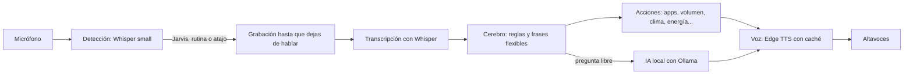

# Jarvis — asistente de voz para Windows

Asistente de voz personal para el computador, escrito en Python. Escucha por el micrófono, entiende órdenes en español, controla el PC (apps, volumen, música, búsquedas, energía) y responde con voz. Funciona **sin gastar tokens de ninguna API de pago**: el reconocimiento de voz y la inteligencia artificial corren en tu propio equipo.

> Proyecto personal, construido paso a paso. Pensado para Windows 10/11.

---

## Contenido

1. [Qué puede hacer](#qué-puede-hacer)
2. [Cómo funciona](#cómo-funciona)
3. [Requisitos](#requisitos)
4. [Instalación](#instalación)
5. [Configuración](#configuración-configjson)
6. [Ejemplos de órdenes](#ejemplos-de-órdenes)
7. [Enseñarle comandos nuevos](#enseñarle-comandos-nuevos)
8. [Inicio automático con Windows](#inicio-automático-con-windows)
9. [Encender el PC desde el iPhone](#encender-el-pc-desde-el-iphone-wake-on-lan)
10. [Privacidad y seguridad](#privacidad-y-seguridad)
11. [Estructura del proyecto](#estructura-del-proyecto)
12. [Herramientas de diagnóstico](#herramientas-de-diagnóstico)
13. [Solución de problemas](#solución-de-problemas)
14. [Limitaciones conocidas](#limitaciones-conocidas)
15. [Hoja de ruta](#hoja-de-ruta)

---

## Qué puede hacer

**Activación**
- Diciendo **"Jarvis"**, ya sea solo o con la orden en la misma frase (*"Jarvis, abre Steam"*).
- Diciendo la frase de una **rutina** sin nombrar a Jarvis (por ejemplo, *"Vamos a trabajar"*).
- Con el atajo de teclado **Ctrl + Alt + J**.

**Órdenes**
- **Aplicaciones:** abrir y cerrar las apps que configures; abrir carpetas y páginas web. Cerrar un juego pide confirmación.
- **Navegador y teclado:** cerrar, abrir y reabrir pestañas, mostrar el escritorio, captura de pantalla, o presionar cualquier combinación (*"presiona control shift t"*).
- **Volumen y música:** subir, bajar, fijar un valor, silenciar; pausar, siguiente y anterior sobre lo que esté sonando.
- **Búsquedas:** en Google y en YouTube, abriéndose en el navegador que elijas.
- **Estado del PC:** uso de procesador, memoria y tarjeta gráfica.
- **Hora, fecha y clima:** el clima usa Open-Meteo (gratuito, sin clave).
- **Temporizadores y recordatorios:** *"temporizador de 10 minutos"*, *"avísame en 25 minutos que saque la pizza"*.
- **Energía:** apagar y reiniciar (con confirmación por voz), bloquear el PC, cancelar un apagado.
- **Rutinas:** conjuntos de acciones (abrir y cerrar apps, ajustar el volumen, bloquear...) que defines en `config.json`.
- **Dictado por voz:** escribe en la ventana activa lo que dices, hasta que digas *"fin del dictado"*.

**Inteligencia artificial local**
- Responde preguntas libres (*"explícame qué es una API"*) con un modelo que corre en tu PC mediante [Ollama](https://ollama.com).
- **Sigue el hilo** de la conversación: después de una respuesta sigue escuchando unos segundos, sin que tengas que volver a decir "Jarvis".
- Usa la tarjeta gráfica solo si hay memoria de video libre; con un juego abierto pasa al procesador.

**Aprendizaje**
- Le puedes **enseñar comandos por voz** (abrir, cerrar, presionar teclas o responder una frase).
- Registra qué órdenes usas más y cuáles no entendió, y te lo cuenta si le preguntas.

**Integración con el sistema**
- Ícono en la bandeja de Windows para pausar, reanudar o salir.
- Arranca solo al iniciar Windows y deja un registro de errores en `jarvis.log`.

---

## Cómo funciona



1. **Escucha continua.** Un modelo de Whisper liviano (`small`, en el procesador) transcribe cada frase que dices. Solo reacciona si detecta "Jarvis" o la frase de una rutina. Todo lo que oye se procesa localmente.
2. **Captura de la orden.** Si dijiste la orden junto con "Jarvis", se usa esa misma frase. Si no, suena un pitido y Jarvis graba **hasta que dejes de hablar**.
3. **El cerebro.** Entiende la orden en tres capas:
   - **Reglas** (expresiones regulares) para órdenes con parámetros: *"abre X"*, *"temporizador de 10 minutos"*, *"pon el volumen en 30"*.
   - **Frases flexibles** (coincidencia aproximada con `rapidfuzz`) para órdenes sueltas: *"¿qué hora es?"*, *"siguiente canción"*. Toleran pequeños errores de transcripción.
   - **Comandos enseñados** que guardas tú mismo en una base de datos local.

   Lo que no encaja con nada puede ir a la IA local (preguntas libres y seguimientos de una conversación).
4. **La acción.** Cada orden llama a un módulo de `acciones/`.
5. **La respuesta.** Jarvis habla con una voz neuronal (Edge TTS, es-CL) y un leve efecto de sala. Las frases que repite se guardan en caché para responder al instante.

### Decisiones de diseño
- **Cero costo por uso:** la voz de entrada (Whisper) y la IA (Ollama) son locales. Solo la voz de salida y el clima usan internet.
- **Todo lo personal vive en `config.json`:** apps, rutas, rutinas, ciudad, modelo de IA. El código no cambia al personalizarlo.
- **Seguridad primero:** ninguna orden hablada se ejecuta como comando de consola; los programas que se pueden abrir salen únicamente de `config.json`. Lo delicado pide confirmación.
- **Que un error no lo mate:** cada ciclo de escucha está protegido; si algo falla, queda en el registro y Jarvis sigue funcionando.

---

## Requisitos

- **Windows 10 u 11**
- **Python 3.11** (recomendado; versiones muy nuevas pueden no tener paquetes compatibles con las librerías de voz)
- Micrófono (probado con audífonos con micrófono)
- Conexión a internet para la voz de salida (Edge TTS) y el clima
- **Opcional, para la IA local:** [Ollama](https://ollama.com) y una tarjeta gráfica con algunos GB libres de memoria de video (también funciona en el procesador, más lento)

---

## Instalación

```powershell
# 1. Clona el repositorio y entra a la carpeta
git clone <URL-de-tu-repositorio>
cd <carpeta-del-proyecto>

# 2. Crea y activa un entorno virtual con Python 3.11
py -3.11 -m venv venv
venv\Scripts\activate

# 3. Instala las dependencias
python -m pip install -r requirements.txt
```

**Configura tu equipo:** abre `config.json` y ajusta las rutas de tus aplicaciones, tu ciudad (para el clima) y lo que quieras cambiar. Valida que el archivo sea JSON correcto:

```powershell
python -c "import json; json.load(open('config.json', encoding='utf-8')); print('config.json OK')"
```

**Instala la IA local (opcional):**

```powershell
# Después de instalar Ollama desde ollama.com/download
ollama pull gemma3:4b
```

**Ejecuta:**

```powershell
python main.py
```

La primera vez, Whisper descarga su modelo (unos 500 MB). Verás un ícono en la bandeja de Windows y oirás "Jarvis en línea".

---

## Configuración (`config.json`)

Todo se personaliza aquí. Un resumen de las secciones:

| Clave | Para qué sirve |
|---|---|
| `voz`, `rate`, `pitch` | Voz de Edge TTS y su velocidad y tono (por ejemplo `es-CL-LorenzoNeural`, `-5%`, `-6Hz`). |
| `umbral_voz` | Volumen mínimo para considerar que estás hablando. Si Jarvis no te oye, bájalo; si se activa con ruido, súbelo. |
| `depurar_voz` | Si vale `true`, registra las transcripciones de escucha, órdenes, confirmaciones y dictado. El valor predeterminado es `false`. |
| `microfono` | *(Opcional)* Parte del nombre del micrófono a usar. Sin esta clave usa el predeterminado de Windows. |
| `ciudad` | Nombre y coordenadas (`lat`, `lon`) para el clima. |
| `ia` | Modelo de Ollama, uso de GPU (`true`, `false` o `"auto"`), tiempo que queda cargado, largo máximo de respuesta y `responder_todo`. |
| `navegador` | Ruta del navegador donde se abren las búsquedas y páginas. |
| `apps` | Lista de aplicaciones (ver abajo). |
| `carpetas` | Nombre hablado y ruta de carpetas que se pueden abrir. |
| `paginas` | Nombre hablado y URL de páginas web. |
| `atajos` | Frases que presionan una combinación de teclas (por ejemplo, cerrar la pestaña). |
| `rutinas` | Conjuntos de acciones que se activan con una frase. |

### Una app

```json
{"nombre": "steam", "alias": ["valve"],
 "abrir": "D:/Steam/Steam.exe",
 "cerrar": "steam.exe",
 "forzar": true}
```

- `abrir`: ruta del ejecutable, un comando (`"code"`), o una lista con argumentos (`["ruta.exe", "--opcion"]`). Acepta variables como `%LOCALAPPDATA%`.
- `cerrar`: nombre(s) del proceso, tal como aparecen en el Administrador de tareas.
- `forzar`: cierra aunque la app se quede en la bandeja (Discord, Steam...).
- `confirmar`: pide confirmación antes de cerrarla (pensado para juegos). Las rutinas **nunca** cierran apps marcadas así.
- `alias`: otros nombres con los que puedes llamarla.

### Una rutina

```json
{"nombre": "estudio",
 "frases": ["modo estudio", "vamos a estudiar"],
 "mensaje": "Modo estudio activado.",
 "acciones": [{"cerrar": "discord"}, {"volumen": 20}, {"abrir": "opera gx"}]}
```

Acciones disponibles: `abrir`, `cerrar`, `volumen`, `presionar` (combinación de teclas), `esperar` (segundos) y `bloquear`. Con `"sin_jarvis": true` la rutina se activa solo con su frase, sin decir "Jarvis".

---

## Ejemplos de órdenes

Todas pueden ir precedidas de "Jarvis".

| Categoría | Ejemplos |
|---|---|
| Hora y fecha | "¿qué hora es?", "¿qué día es hoy?" |
| Aplicaciones | "abre Steam", "cierra Discord", "abre descargas", "abre YouTube" |
| Pestañas y teclado | "cierra la pestaña", "nueva pestaña", "reabre la pestaña", "presiona control shift t" |
| Volumen | "sube el volumen", "pon el volumen en 30", "silencio" |
| Música | "pausa", "siguiente canción", "canción anterior" |
| Búsquedas | "busca recetas de pan en YouTube", "busca el clima en Google" |
| Estado del PC | "¿cómo está el PC?" |
| Clima | "dime el clima", "¿va a llover mañana?" |
| Temporizadores | "temporizador de 10 minutos", "avísame en 25 minutos que saque la pizza", "cuánto falta", "cancela el temporizador" |
| Dictado | "dicta" … "fin del dictado" |
| Energía | "apaga el PC" (pide confirmación), "reinicia el computador", "bloquea el PC", "cancela el apagado" |
| Rutinas | "vamos a trabajar", "modo estudio", "buenas noches" |
| IA | "explícame qué es una API", "¿y para qué sirve?", "nueva conversación" |
| Terminar una charla | "gracias", "eso es todo" |

---

## Enseñarle comandos nuevos

```
Jarvis, aprende, cuando diga modo música, abre Spotify
Jarvis, aprende, cuando diga adiós música, cierra Spotify
Jarvis, aprende, cuando diga pestaña rápida, presiona control t
Jarvis, aprende, cuando diga cómo estás, responde todo en orden
```

- Los verbos admitidos son **abre**, **cierra**, **presiona** y **responde**.
- Para abrir o cerrar algo, la app debe existir en `config.json`.
- Si una versión anterior guardó un comando de cierre o de teclado como respuesta, vuelve a enseñarlo con la misma frase para actualizarlo.
- Para quitar uno: *"olvida modo música"*.
- Para ver el historial: *"¿qué es lo que más uso?"*, *"¿qué no has entendido?"*, *"¿qué comandos me has enseñado?"*.

Todo se guarda en `datos/jarvis.db` (SQLite), una base local que no se sube al repositorio.

---

## Inicio automático con Windows

Con el entorno virtual activo y desde la carpeta del proyecto, crea un acceso directo en la carpeta de inicio:

```powershell
$ws = New-Object -ComObject WScript.Shell
$acceso = $ws.CreateShortcut("$env:APPDATA\Microsoft\Windows\Start Menu\Programs\Startup\Jarvis.lnk")
$acceso.TargetPath = "$PWD\venv\Scripts\pythonw.exe"
$acceso.Arguments = "`"$PWD\main.py`""
$acceso.WorkingDirectory = "$PWD"
$acceso.Save()
```

Usa `pythonw.exe` para que no abra ventana de consola. Lo que se imprime pasa a `jarvis.log`. Para quitarlo, borra `Jarvis.lnk` de la carpeta que abre `shell:startup` (Win + R).

> Si ejecutas Jarvis desde la terminal de VS Code, cerrar VS Code también lo cierra. El inicio automático no tiene ese problema.

---

## Encender el PC desde el iPhone (Wake-on-LAN)

Esto **no es parte del código de Jarvis**: cuando el PC está apagado no hay ningún programa corriendo. Lo que enciende el equipo es la tarjeta de red, al recibir un paquete especial (*Magic Packet*). Para que funcione:

1. El PC debe ir conectado por **cable Ethernet** (por Wi-Fi casi nunca funciona).
2. En la **BIOS**: activar el encendido por red (según la placa, *Wake on LAN* o *Power On By PCI-E*) y **desactivar ErP**.
3. En **Windows**: en las propiedades del adaptador de red, permitir que el dispositivo reactive el equipo y habilitar *Wake on Magic Packet*; además, desactivar el **inicio rápido**.
4. Enviar el paquete con la MAC del adaptador, desde una app de Wake-on-LAN en el iPhone o desde un Atajo de Siri (así también se enciende por voz).

Funciona **dentro de la red local**. Al encender, Windows llega a la pantalla de inicio de sesión y Jarvis arranca cuando entras.

---

## Privacidad y seguridad

- **Lo que se queda en tu PC:** el reconocimiento de voz (Whisper), la inteligencia artificial (Ollama), la base de datos de aprendizaje y la caché de voz.
- **Lo que usa internet:** la voz de salida (Edge TTS, se envía el texto que Jarvis va a decir) y el clima (Open-Meteo, se envían las coordenadas de `ciudad`).
- **Confirmaciones:** apagar, reiniciar y cerrar juegos piden una respuesta afirmativa breve, como «sí» o «confirmo».
- **Registro de voz:** las transcripciones de diagnóstico están desactivadas de forma predeterminada. Si activas `depurar_voz` y usas `pythonw.exe`, se guardan en `jarvis.log`.
- **Sin ejecución de texto hablado:** las órdenes habladas solo eligen entre acciones que ya existen; nunca se pasan a la consola.
- **No hay borrado de archivos por voz**, a propósito: es demasiado fácil que un error de transcripción borre algo importante.
- **No subas datos personales:** `.gitignore` excluye `venv/`, `datos/` (base de datos y caché de voz), `*.log`, `*.onnx` y `models/`. Revisa `config.json` antes de publicarlo: contiene rutas de tu equipo.

---

## Estructura del proyecto

```
.
├── main.py                 # Bucle principal: escuchar, entender, actuar, responder
├── bandeja.py              # Ícono de la bandeja (pausar, reanudar, salir)
├── config.py               # Carga config.json
├── config.json             # Toda la personalización
├── requirements.txt
│
├── voz/
│   ├── activacion.py       # Escucha continua y detección de "Jarvis" / rutinas / atajo
│   ├── escuchar.py         # Graba hasta que dejas de hablar y transcribe
│   ├── hablar.py           # Voz de salida (Edge TTS), efecto y caché
│   └── dictado.py          # Dictado por voz en la ventana activa
│
├── cerebro/
│   ├── intenciones.py      # Reglas y frases flexibles; decide qué acción ejecutar
│   ├── aprendizaje.py      # Comandos enseñados, historial y estadísticas (SQLite)
│   └── confirmacion.py     # Acciones que esperan un "sí" o "no"
│
├── acciones/
│   ├── apps.py             # Abrir y cerrar apps, carpetas, páginas y teclas
│   ├── rutinas.py          # Conjuntos de acciones
│   ├── volumen.py          # Control de volumen de Windows
│   ├── multimedia.py       # Pausa, siguiente y anterior
│   ├── temporizadores.py   # Temporizadores y recordatorios
│   ├── clima.py            # Pronóstico (Open-Meteo)
│   ├── sistema.py          # Estado del PC
│   ├── energia.py          # Apagar, reiniciar, bloquear
│   ├── hora_fecha.py       # Hora y fecha
│   ├── web.py              # Búsquedas en el navegador
│   └── ia.py               # Conexión con Ollama y memoria de la conversación
│
└── datos/                  # Se crea sola: base de datos y caché de voz (no se sube a Git)
```

---

## Herramientas de diagnóstico

Scripts sueltos, en la raíz del proyecto, para detectar problemas sin depender de la voz:

| Script | Para qué sirve |
|---|---|
| `prueba_cerebro.py` | Escribes una orden y muestra cómo la entiende y qué responde. Ejecuta las acciones de verdad. |
| `python -m sounddevice` | Lista las entradas y salidas de audio disponibles. |
| `python -m unittest discover -s tests` | Ejecuta pruebas de regresión con acciones del sistema simuladas. |

---

## Solución de problemas

**Jarvis no me escucha**
- Para diagnosticar el micrófono, activa `"depurar_voz": true` en `config.json` y ejecuta `python main.py` con la consola abierta. Las líneas `[oído] ...` indican que Whisper está transcribiendo. Desactiva la opción cuando termines.
- Baja `umbral_voz` en `config.json` (por ejemplo a `0.005`).
- En *Configuración → Sistema → Sonido → Entrada*, elige el micrófono correcto. Cuidado con entradas de línea o de "mezcla", que captan el audio del PC en vez de tu voz.
- Revisa que no tengas **dos copias de Jarvis** abiertas: se pelean el micrófono.
- Algunos audífonos silencian el micrófono al levantar el brazo, o lo toman otras apps (Discord, OBS...).

**Entiende mal una palabra** (por ejemplo, "cierra" como "sierra")
- Whisper a veces confunde palabras parecidas. Hay una corrección para "sierra/sierre/cierre" en `cerebro/intenciones.py`; para otros casos, usa un sinónimo o enséñale el comando.

**Error de `config.json`** al arrancar
- Casi siempre es una coma de más antes de un `}` o `]`. Valídalo con el comando de la sección de instalación; el mensaje indica la línea exacta.

**"No pude conectarme a Ollama"**
- Abre la aplicación Ollama (menú Inicio) y comprueba que el modelo esté descargado con `ollama list`.

**No habla, pero sí entiende**
- La voz de salida necesita internet. Sin conexión, Jarvis solo puede decir las frases que ya tenía guardadas en caché.

**La instalación falla con Python muy reciente**
- Usa Python 3.11 en el entorno virtual.

---

## Limitaciones conocidas

- Solo Windows.
- Los temporizadores y recordatorios viven en memoria: **se pierden si cierras o reinicias Jarvis**.
- Los modelos pequeños de IA explican bien conceptos, pero **se equivocan en datos precisos** (fechas, cifras, nombres).
- Sin conexión no hay voz nueva ni clima.
- El reconocimiento depende del micrófono, el ruido y la dicción; con el modelo actual a veces conviene repetir.

---

## Hoja de ruta

### En desarrollo — aún **no** integrado en el código

**Reconocimiento más preciso.** Diseñado y probado con modelos simulados; falta integrarlo y probarlo con audio real.
- **Dos modelos de Whisper:** el rápido (`small`, en el procesador) sigue escuchando siempre. Al dar una orden entra un modelo mucho más preciso (`large-v3-turbo`, en la tarjeta gráfica) que transcribe lo que dices. La GPU solo trabaja cuando hablas y se libera de la memoria tras 3 minutos de inactividad.
- **Sin GPU libre nada se rompe:** con un juego ocupando la memoria de video, o si la GPU no está configurada, se sigue usando el modelo rápido.
- **Vocabulario propio:** Whisper recibe tus apps y páginas ("Opera GX", "iTero", "Modrinth", "OBS"...) como palabras que debe esperar oír.
- **Menos frases inventadas:** descarta lo que el propio modelo considera ruido o poco fiable, y alucinaciones típicas ("suscríbete", "subtítulos de Amara.org").
- **Diccionario de correcciones** en `config.json` para errores que se repiten ("y tero" → "itero", "espotif" → "spotify").
- **Herramientas nuevas:** `probar_gpu.py` (comprueba la tarjeta gráfica en un proceso aparte) y `probar_reconocimiento.py` (compara qué entiende cada modelo).

### Ideas siguientes
- **Portapapeles con IA:** "resume lo que copié", "tradúcelo al inglés", "explícame este código".
- **Recordatorios con hora del reloj** que sobrevivan al reinicio, y una rutina de "buenos días" con la hora, el clima y los pendientes.
- **Calculadora exacta** ("¿cuánto es el 15 por ciento de 80?"), porque la IA se equivoca en matemáticas.
- **Callar a Jarvis** con una tecla (o por voz) mientras habla.
- Pomodoro, notas por voz y alertas del PC (temperatura de la GPU, poco espacio en disco).
- "¿Qué hay en mi pantalla?" con un modelo que entienda imágenes.

### Descartado
- Control remoto del PC desde fuera de casa (con un Raspberry Pi o una VPN).

---

## Tecnologías

[faster-whisper](https://github.com/SYSTRAN/faster-whisper) (reconocimiento de voz) · [edge-tts](https://github.com/rany2/edge-tts) (voz de salida) · [Ollama](https://ollama.com) (IA local) · [Open-Meteo](https://open-meteo.com) (clima) · [RapidFuzz](https://github.com/rapidfuzz/RapidFuzz) (coincidencia aproximada de frases) · [Pedalboard](https://github.com/spotify/pedalboard) (efecto de voz) · [pycaw](https://github.com/AndreMiras/pycaw) (volumen de Windows) · [pystray](https://github.com/moses-palmer/pystray) (ícono de bandeja) · SQLite
